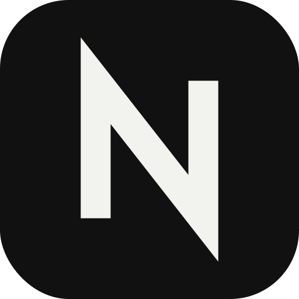
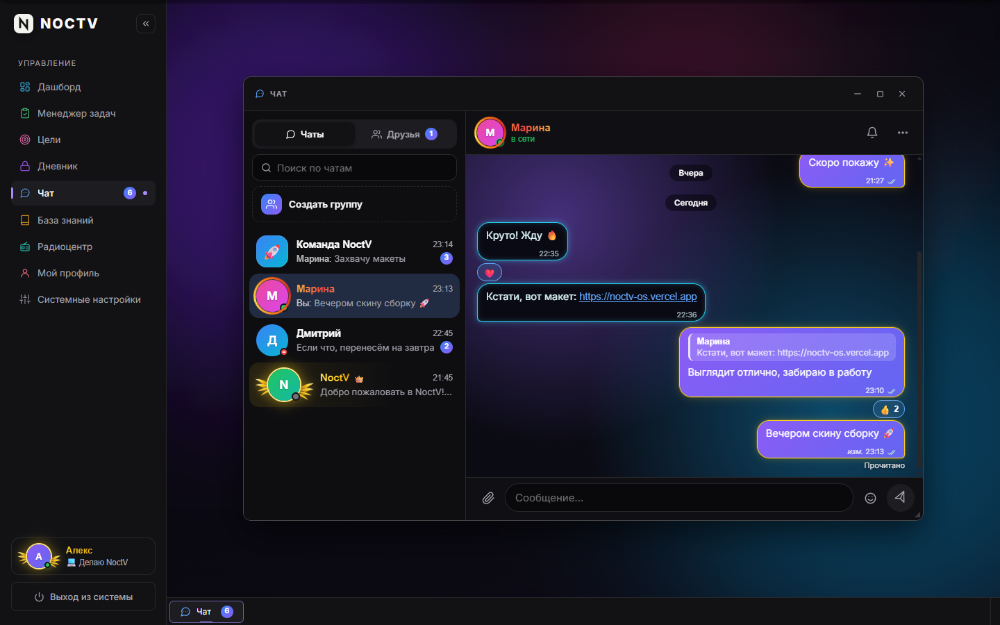
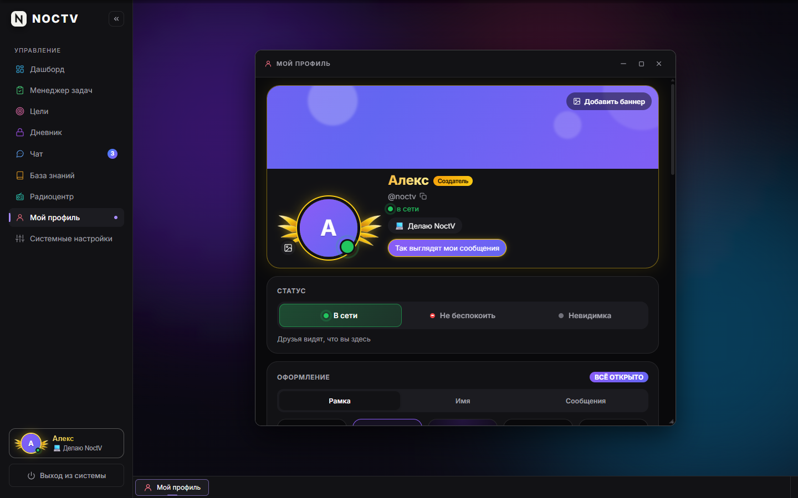
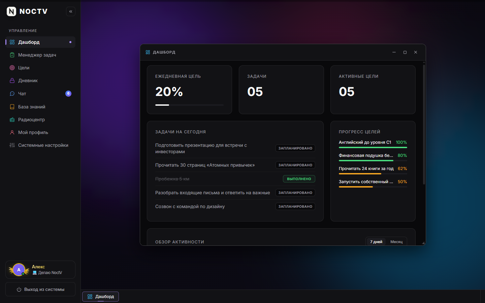
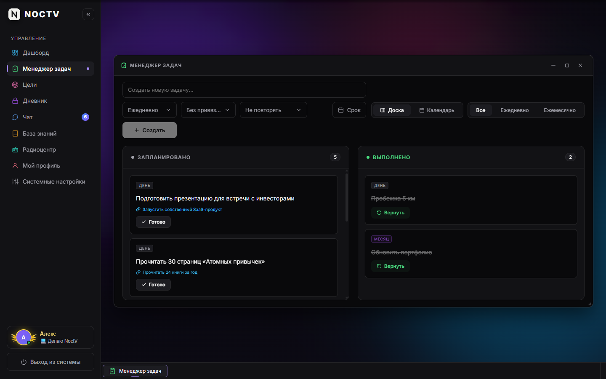
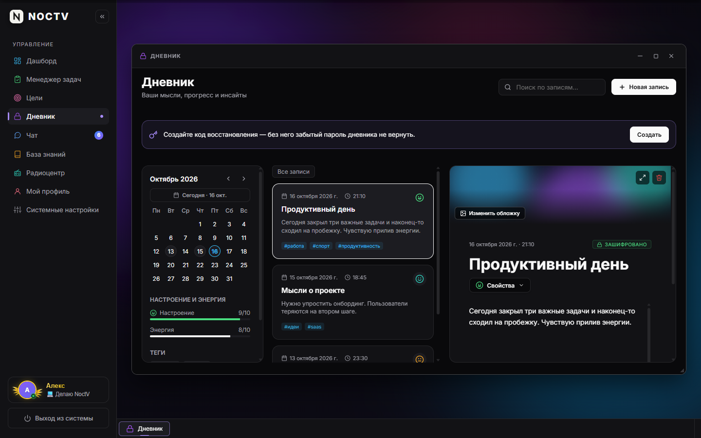
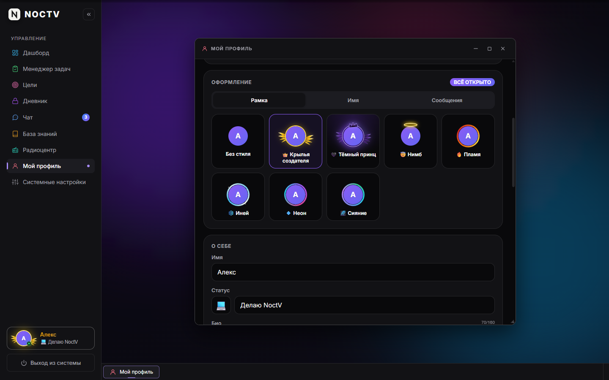
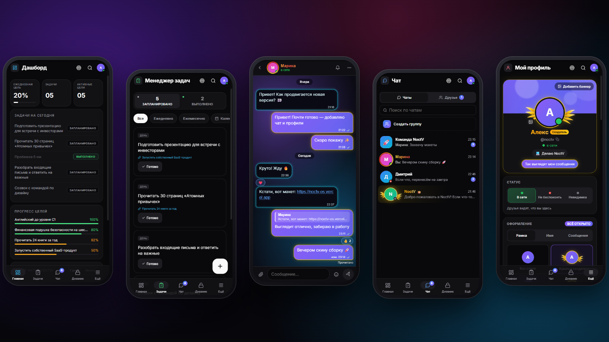

<picture>
  <source media="(prefers-color-scheme: dark)" srcset="docs/logo-light.png" />
  
</picture>

# NoctV OS

**Личная ОС продуктивности и закрытый мессенджер для Windows**

Задачи, цели, зашифрованный дневник, база знаний, чат с друзьями, 
личный профиль, режим фокуса и радио — в одном приложении.

 

&nbsp;

  

 

 

## 💡 Что внутри

<table>
  <tr>
    <td width="33%" valign="top">
      <h3>📋 Задачи и цели</h3>
      Доска и календарь, привычки с серией 🔥, сроки до минуты, напоминания, цели с этапами и графики прогресса.
    </td>
    <td width="33%" valign="top">
      <h3>🔒 Дневник и знания</h3>
      Дневник, зашифрованный вашим паролем, и база знаний с удобным редактором, таблицами и чек-листами.
    </td>
    <td width="33%" valign="top">
      <h3>💬 Чат с друзьями</h3>
      Личные и групповые чаты, реакции, фото, «печатает…», свой фон для каждого чата и уведомления.
    </td>
  </tr>
  <tr>
    <td width="33%" valign="top">
      <h3>👤 Профиль</h3>
      Фото и баннер, статус, режимы «в сети / не беспокоить / невидимка», достижения и оформление — вплоть до «Тёмного принца» 🖤
    </td>
    <td width="33%" valign="top">
      <h3>🎯 Фокус и радио</h3>
      Помодоро с пресетами и статистикой, полноэкранный таймер и встроенное lo-fi радио.
    </td>
    <td width="33%" valign="top">
      <h3>☁️ Везде одинаково</h3>
      Один аккаунт на компьютере, в браузере и на телефоне — всё синхронизируется мгновенно.
    </td>
  </tr>
</table>

 

## 📸 Как это выглядит

<table>
  <tr>
    <td width="50%">
<b>Чат с друзьями</b>
</td>
    <td width="50%">
<b>Личный профиль</b>
</td>
  </tr>
  <tr>
    <td width="50%">
<b>Дашборд</b>
</td>
    <td width="50%">
<b>Менеджер задач</b>
</td>
  </tr>
  <tr>
    <td width="50%">
<b>Зашифрованный дневник</b>
</td>
    <td width="50%">
<b>Оформление профиля</b>
</td>
  </tr>
</table>

Скриншоты сделаны на демонстрационных данных.

 

## ⬇️ Установка на Windows

1. Откройте **[последний релиз](https://github.com/NoctV/noctv-os-releases/releases/latest)**.
2. Скачайте файл **`NoctV-OS-Setup-<версия>.exe`** в разделе *Assets*.
3. Запустите его и следуйте шагам установщика.
4. Войдите под своим логином — все данные подтянутся сами.

> [!NOTE]
> Windows может показать окно SmartScreen, потому что установщик не подписан платным сертификатом.
> Нажмите **«Подробнее» → «Выполнить в любом случае»**.

## 📱 На телефоне

Откройте **[noctv-os.vercel.app](https://noctv-os.vercel.app)** и установите как приложение:

| iPhone | Android |
|---|---|
| Safari → «Поделиться» → **«На экран „Домой“»** | Chrome → меню ⋮ → **«Добавить на главный экран»** |

Так приложение откроется на весь экран и сможет присылать уведомления о сообщениях.

 

## 🔄 Обновления

Устанавливать новые версии вручную не нужно: приложение само проверяет этот репозиторий, скачивает обновление в фоне и предлагает перезапуститься. После обновления оно покажет, что нового. Проверить вручную можно в **Настройках → Обновления**.

 

## ❓ Вопросы

<b>Нужен ли интернет?</b>

 
Для входа и синхронизации — да. Задачи можно создавать и отмечать без сети: изменения отправятся сами, когда связь вернётся.

<b>Насколько безопасны мои данные?</b>

 
Доступ закрытый — только для зарегистрированных участников. Каждая запись доступна только владельцу, переписка — только участникам чата. Дневник шифруется вашим паролем прямо на устройстве: его не знает даже сервер.

<b>Кто меня видит в чате?</b>

 
Только ваши друзья. Чтобы добавить друга, введите его логин во вкладке «Друзья» — он получит заявку.

<b>Как удалить программу?</b>

 
«Параметры Windows» → «Приложения» → NoctV OS → «Удалить». Ваши данные останутся в аккаунте.

 

<picture>
  <source media="(prefers-color-scheme: dark)" srcset="docs/logo-light.png" />
  
</picture>

NoctV OS · сделано с ☕ и lo-fi битами

