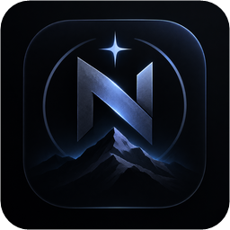

# NoctV OS — релизы

Здесь публикуются установщики **NoctV OS** для Windows. 
Приложение само проверяет этот репозиторий и обновляется автоматически.

**[⬇ Скачать последнюю версию](https://github.com/NoctV/noctv-os-releases/releases/latest)**

## Установка

1. Откройте [последний релиз](https://github.com/NoctV/noctv-os-releases/releases/latest).
2. Скачайте файл `NoctV-OS-Setup-<версия>.exe`.
3. Запустите его и следуйте шагам установщика.

Windows может показать предупреждение SmartScreen, потому что установщик не подписан сертификатом: нажмите **Подробнее → Выполнить в любом случае**.
